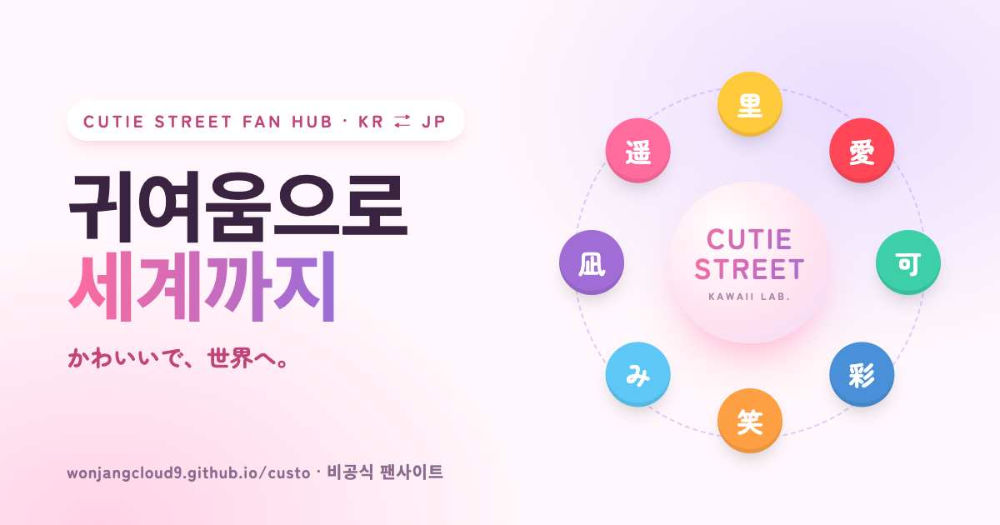

<p align="center">
  
</p>

<p align="center">
  <strong>✨ Custo — CUTIE STREET 비공식 팬허브 ✨</strong><br>
  귀여움으로 세계까지 · かわいいで、世界へ。
</p>

<p align="center">
  <a href="https://wonjangcloud9.github.io/custo/">🌐 사이트 바로가기</a> ·
  <a href="https://wonjangcloud9.github.io/custo/start/">🎓 처음이라면 입문 퀘스트</a>
</p>

---

## 소개

**Custo**는 KAWAII LAB.의 8인조 아이돌 [CUTIE STREET](https://cutiestreet.asobisystem.com)(큐티스트리트)의 한국 팬을 위한 비공식 팬허브입니다.
멤버·영상·스케줄·디스코그래피를 한곳에 모으고, 덕질하면서 일본어도 배울 수 있어요.

## 주요 기능

| | 페이지 | 내용 |
|---|---|---|
| 🏠 | 홈 | 키네틱 히어로, 실시간 카운트다운, 공식 소식 티커, 오늘의 레전드 컷, ON THIS DAY |
| 💖 | 멤버 (8명) | 멤버 컬러 테마 프로필, 홀로 ID 카드, 인스타풍 레전드 피드(더블탭 ♥), 생일 모드 |
| 🗻 | 정상까지의 여정 | three.js 3D 스크롤 스토리 — 데뷔부터 紅白까지 후지산 3,776m 등반 |
| 🎬 | 영상 아카이브 | 공식 채널 500편+ · 공식 MV(한국어 버전 포함), 카테고리·멤버 필터, 연속 재생, 통계 대시보드 |
| 💿 | 디스코그래피 / CUTIE LAND | 공식 31릴리즈 레코드 선반, 1st 앨범 16트랙 가이드 |
| 🗓️ | 스케줄 · 공식 소식 | 공식 일정 타임라인, .ics/구글 캘린더, 한국어 소식 요약 |
| 🎍 | 紅白 특집 | 플립 시계 카운트다운, 방송 정보, 응원 포스트잇 |
| 💞 | 유닛 & 케미 · 🔮 닮은 멤버 · 🔦 펜라이트 | 케미 파인더, 6문항 테스트, 펜라이트 바다 시뮬레이터 |
| 🔤 | 일본어 배우기 | 히라가나·문법·현장 일본어·가사로 배우기, 퀴즈 & SRS |

⌘K(또는 `/`)로 어디서든 통합 검색, 홈 화면에 추가(PWA) 가능.

## 콘텐츠 원칙

- **사실은 검증된 것만** — 공식 사이트·공식 YouTube·Wikipedia(일본어)·주요 매체로 확인한 정보만 싣고, 출처를 남깁니다.
- **이미지는 공식 임베드만** — 멤버 사진을 저장·재배포하지 않고 공식 YouTube 썸네일/임베드를 사용합니다. 멤버 얼굴 AI 생성 이미지는 사용하지 않습니다.
- 모든 영상·이미지의 권리는 각 권리자(ASOBISYSTEM / KAWAII LAB.)에게 있습니다.

## 기술 스택

- [VitePress](https://vitepress.dev/) + [Vue 3](https://vuejs.org/) — 정적 사이트 + 인터랙티브 컴포넌트
- [three.js](https://threejs.org/) — 3D 여정 (지연 로딩)
- 최신 CSS — View Transitions, scroll-driven animations, `linear()` 스프링, `@starting-style`, container queries
- [GitHub Pages](https://pages.github.com/) — `main` 푸시 시 자동 배포

## 데이터 갱신

```bash
node loop/refresh.mjs   # 공식 채널 RSS → 새 영상·MV·멤버 컷 추가 후 데이터 재생성
```

## 로컬 개발

```bash
npm install
npm run docs:dev     # 개발 서버 (localhost:5173)
npm run docs:build   # 프로덕션 빌드
npm run docs:preview # 빌드 프리뷰
```

## 라이선스

코드: MIT · 콘텐츠의 영상/이미지 권리는 각 권리자에게 있습니다.
